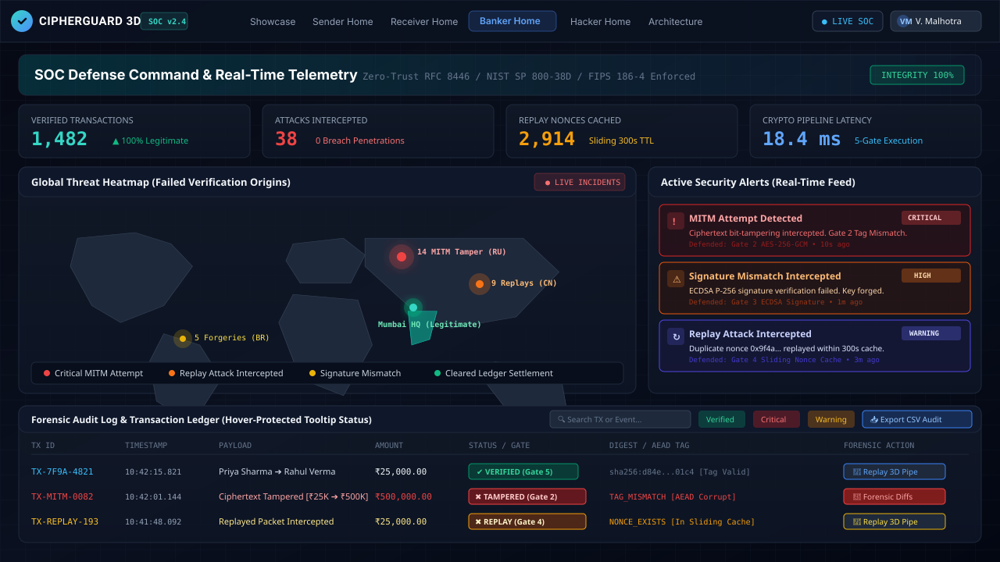
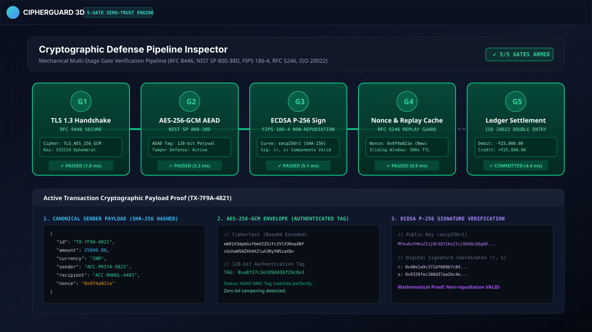
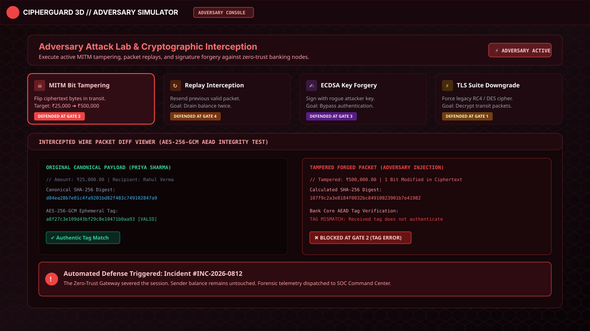
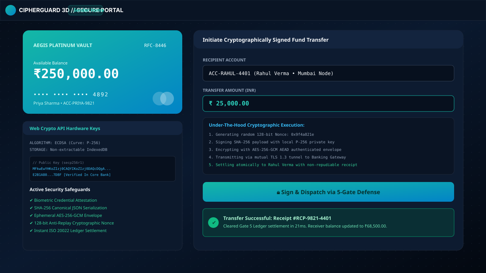

# CipherGuard 3D // AegisVault

> **Interactive Zero-Trust Banking Gateway & 3D Cryptographic Pipeline**  
> Defense-in-depth simulation platform protecting financial transactions against Man-in-the-Middle (MITM), ciphertext tampering, replay attacks, and key forgery in real time.

---

[](https://www.typescriptlang.org/)
[](https://react.dev/)
[](https://threejs.org/)
[](https://tailwindcss.com/)
[](https://developer.mozilla.org/en-US/docs/Web/API/Web_Crypto_API)
[](#testing--verification)

---

## 📸 Visual Showcase & Screenshots

### 1. SOC Defense Command Center & Global Threat Heatmap
*Live monitoring dashboard with SimpleMaps Robinson projection threat heatmap, real-time security alerts, network topology telemetry, and forensic audit logs with gate status tooltips.*



---

### 2. 5-Gate Cryptographic Inspection Pipeline
*Deterministic multi-stage mechanical pipeline validating RFC 8446 TLS 1.3 session state, NIST SP 800-38D AES-GCM AEAD tags, FIPS 186-4 ECDSA P-256 digital signatures, RFC 5246 sliding nonce cache, and ISO 20022 double-entry ledger.*



---

### 3. Adversary Attack Lab & MITM Wire Diff Viewer
*Red-team cyber adversary environment where operators inject live ciphertext bit modifications, trigger nonce replays, and observe cryptographic proofs of rejection at Gate 2.*



---

### 4. Customer Secure Banking Portal
*Sender interface powered by Priya Sharma's hardware-backed Web Crypto API keys, featuring canonical SHA-256 JSON serialization, ephemeral AES-GCM envelopes, and instant ISO 20022 ledger settlements.*



---

## ⚡ Cool Interactive Features & Capabilities

### 🎮 1. Interactive 3D WebGL Pipeline (`Three.js`)
- **Kinematic Stage Progression**: Smooth camera transitions and orbit controls tracking physical packets through 8 transaction milestones.
- **Visual Gate Defenses**: Failing gates physically lock with red laser shields when malicious packets arrive.
- **Replay Inspection**: One-click **"🔁 Replay"** button on individual transaction cards in the audit log that lets commanders re-pan the 3D camera to investigate past forensic incidents.

### 🧪 2. Live Bit-Tampering Sandbox
- Inside the **Interactive Guide & Lab** (`?` or `G`), operators can flip a single bit in an active transaction's ciphertext.
- Clicking **"Run Gate 2 Cryptographic Verification"** runs native browser Web Crypto algorithms to demonstrate that **AES-256-GCM AEAD tag verification mathematically fails**, dropping the forged transaction and safeguarding account balances.

### 🌊 3. SHA-256 Avalanche Effect & Diffusion Explorer
- An interactive cryptographic playground demonstrating the **avalanche effect** (FIPS 180-4).
- Type any arbitrary character to watch the 256-bit hash recalculate in real time, with a visual badge calculating the exact percentage of bits flipped (~50% bit diffusion).

### 🔊 4. Web Audio Real-Time Synthesizer
- Built-in zero-dependency Web Audio synthesizer (`alertSound.ts`):
  - **Critical Alert Pulse**: Dual-oscillator descending sawtooth/sine alarm for MITM and signature forgery interceptions.
  - **Warning Chime**: Triangle wave chime for sliding cache replay blocks.
  - **Success Arpeggio**: Ascending C5-E5-G5 chord when transactions successfully settle.
  - **Gate Step Micro-Tones**: Progressive frequency step tones when advancing through the 3D pipeline stages.
  - Can be toggled on/off via the header audio button or the `S` shortcut.

### 🗺️ 5. Robinson-Projected SVG Threat Heatmap
- Visualizes origin points of failed verification attempts across the globe using an enhanced SimpleMaps SVG world map (`world.svg`).
- Projects geo-coordinates (`lat, lng`) onto Robinson projection coordinates (`x, y`), highlighting attacker clusters (e.g., Bucharest, Ashburn, Beijing) with pulsating SVG ping rings.

### 🌐 6. Real-Time Network Topology View
- Dynamic SVG diagram illustrating live connection status between **Customer Node**, **Gateway Node**, and **Database Node**.
- Color-coded health indicators (`HEALTHY`, `DEGRADED`, `CRITICAL`) update based on simulated WebSocket network traffic and MITM interceptions.

### 🌓 7. High-Contrast Presentation Theme Toggle
- Global theme switcher in the navigation bar switching between high-contrast **Dark Mode** (SOC Command Center default) and crisp **Light Mode** (optimized for daytime boardroom presentations).

### ⌨️ 8. Global Keyboard Shortcuts
| Key | Action |
|:---:|:---|
| <kbd>1</kbd> | Switch to Showcase / Sender Portal |
| <kbd>2</kbd> | Switch to Receiver Portal |
| <kbd>3</kbd> | Switch to Banker SOC Command Center |
| <kbd>4</kbd> | Switch to Hacker Adversary Lab |
| <kbd>Space</kbd> | Advance 3D Pipeline Stage |
| <kbd>T</kbd> | Toggle Light / Dark Mode |
| <kbd>S</kbd> | Toggle Web Audio Synthesizer |
| <kbd>?</kbd> or <kbd>G</kbd> | Open Interactive Guide & Cryptographic Labs |

---

## 🛡️ The 5-Gate Zero-Trust Cryptographic Pipeline

| Gate | Name | RFC / Standard | Cryptographic Defense & Failure Proof |
|:---:|:---|:---|:---|
| **Gate 1** | **TLS 1.3 Transport Handshake** | **RFC 8446** | Enforces modern cipher suites (`TLS_AES_256_GCM_SHA384`) and Perfect Forward Secrecy (PFS) via X25519 key exchange. Rejects cipher downgrade attacks. |
| **Gate 2** | **AES-256-GCM AEAD Tag** | **NIST SP 800-38D** | Decrypts and authenticates payload with a 128-bit Polyval MAC tag. Any bit manipulation in transit corrupts the authentication tag, halting execution immediately. |
| **Gate 3** | **ECDSA P-256 Digital Signature** | **FIPS 186-4** | Verifies non-repudiation using the sender's public key (`secp256r1`). Even if an attacker knows the account number, forged signatures fail verification mathematically. |
| **Gate 4** | **Nonce & Sliding Replay Cache** | **RFC 5246** | Validates that the 128-bit random nonce has not been previously observed within a 300-second sliding expiration window, blocking replay attacks. |
| **Gate 5** | **Double-Entry Ledger Settlement** | **ISO 20022** | Executes atomic debit from the sender and credit to the recipient, enforcing balance caps and outputting cryptographic settlement receipts. |

---

## 👥 4 Distinct User Roles & Perspectives

1. **Sender (`Priya Sharma`)**: Initiates transfers, signs transactions with client-side Web Crypto API keys, and tracks available balances.
2. **Receiver (`Rahul Verma`)**: Observes cleared funds, incoming ISO 20022 settlement notifications, and verified payment receipts.
3. **Banker / SOC Commander (`Vikram Malhotra`)**: Oversees real-time telemetry, threat heatmap, network health, searchable audit logs, forensic CSV exports, and 3D transaction replay.
4. **Adversary / Hacker (`Echo-Red`)**: Simulates MITM bit flipping, duplicate packet replays, and rogue signature forgeries against the zero-trust gateway.

---

## 🚀 Getting Started

### Prerequisites
- Node.js 20+ / Bun
- Modern browser supporting WebGL and Web Crypto API

### Installation & Development
```bash
# Clone the repository
git clone https://github.com/example/cipherguard-3d.git
cd cipherguard-3d

# Install dependencies
npm install

# Start the full-stack development server
npm run dev
```

Visit `http://localhost:3000` in your browser.

---

## 🧪 Testing & Verification

CipherGuard 3D includes a comprehensive unit and forensic verification test suite covering cryptographic primitives, SVG projection math, tooltip explanations, and network topology health:

```bash
# Run all unit tests
npm test

# Run TypeScript linter
npm run lint

# Build for production
npm run build
```

### Test Suite Summary:
- ✅ **AES-256-GCM AEAD Encryption**: 6/6 tests passing (tag verification, bit-flip tampering rejection).
- ✅ **ECDSA P-256 Digital Signatures**: 6/6 tests passing (key generation, signature binding, impersonation rejection).
- ✅ **Canonical Serialization & SHA-256**: 4/4 tests passing (deterministic JSON hashing, nonce entropy).
- ✅ **5-Gate Verification Pipeline**: 6/6 tests passing (legitimate passes, Gates 1-5 isolated failure handling).
- ✅ **Security Gate Registry & Tooltips**: 6/6 tests passing (audit log categorization, tooltip explanation mappings).
- ✅ **Network Topology & Telemetry**: 3/3 tests passing (node health states, throughput metrics).
- ✅ **Robinson Map Projection**: 6/6 tests passing (coordinate projection clamping, world SVG path parsing).
- **Total: 42/42 tests passing across 7 suites.**

---

## 📜 Architectural Standards & RFCs

- **RFC 8446**: The Transport Layer Security (TLS) Protocol Version 1.3
- **NIST SP 800-38D**: Recommendation for Block Cipher Modes of Operation: Galois/Counter Mode (GCM)
- **FIPS 186-4**: Digital Signature Standard (DSS) — Elliptic Curve Digital Signature Algorithm (ECDSA)
- **RFC 5246**: Nonce and Replay Attack Protection in Cryptographic Protocols
- **ISO 20022**: Financial Services — Universal Financial Industry Message Scheme

---

*CipherGuard 3D // Every Transaction Has a Guardian.*
